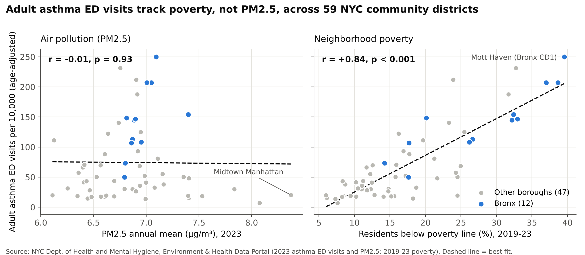

# Asthma and Air Quality in the Bronx

Independent research by Melissa Gonzalez, Queens College (CUNY), November 2026.

**Question:** Do New York City neighborhoods with more fine-particle air pollution (PM2.5) have higher asthma emergency department (ED) visit rates, and does that hold after accounting for neighborhood poverty?

**Answer:** Across NYC's 59 community districts, asthma ED visit rates track neighborhood poverty closely (adults r = +0.84, children 5-17 r = +0.75, both p < 0.001), but show no relationship with modeled annual PM2.5 (adults r = -0.01, children r = +0.10). Poverty explains about 70% of the variation in adult rates. The Bronx has the highest rates of any borough (143 adult ED visits per 10,000 vs. 74 citywide), at about the level its poverty predicts.

## Data

All data come from the NYC Department of Health and Mental Hygiene's [Environment & Health Data Portal](https://a816-dohbesp.nyc.gov/IndicatorPublic/), via its public repository [nychealth/EHDP-data](https://github.com/nychealth/EHDP-data).

| Variable | Indicator (ID / measure) | Year | Unit |
|---|---|---|---|
| Adult asthma ED visits | 2380 / 1199, age-adjusted rate | 2023 | per 10,000 |
| Child asthma ED visits, ages 5-17 | 2379 / 1196 | 2023 | per 10,000 |
| PM2.5 annual mean (NYCCAS) | 2023 / 1425 | 2023 | µg/m³ |
| NO2 annual mean (NYCCAS) | 2025 / 1431 | 2023 | ppb |
| Poverty | 103 / 221 | 2019-23 | % of residents |

`data/nyc_asthma_air_by_district.csv` is the merged dataset, one row per community district.

## Code

Python 3 with pandas, NumPy, SciPy and matplotlib.

1. `code/build_dataset.py <path to EHDP-data clone> data/nyc_asthma_air_by_district.csv` builds the dataset.
2. `code/analyze.py data/nyc_asthma_air_by_district.csv results.csv` runs correlations, regressions (OLS with HC1 robust standard errors) and Bronx residuals. Output is saved in `results_output.txt`.
3. `code/make_charts.py results.csv figures` draws the figures.

## Limitations

- Ecological data: neighborhood averages show association, not cause, and say nothing about individuals.
- One year (2023) of asthma and air data.
- PM2.5 is modeled from about 100 monitors plus land-use data.
- Poverty for 2019-23 is published for 2020 Community District Tabulation Areas, matched to community districts by borough and district number.
- Other factors (housing quality, smoking, access to primary care) were not measured.
